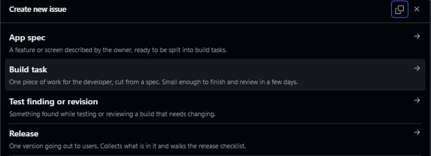
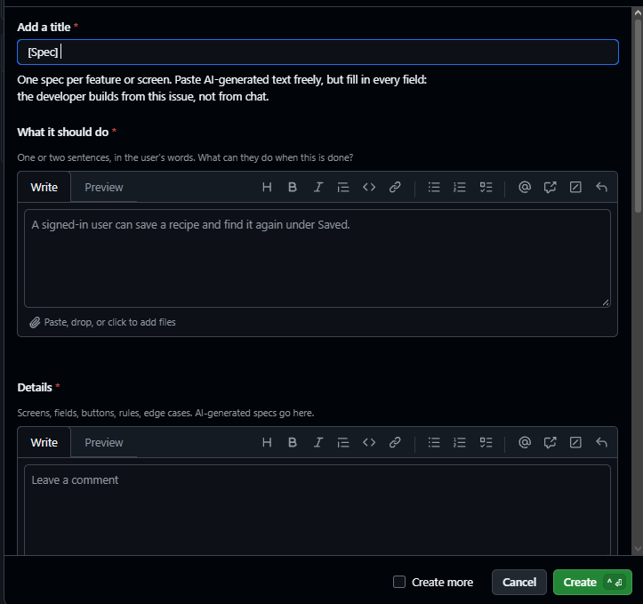

# Spec to release on GitHub, for AI-assisted app teams

**A ready-made workflow for small teams where the owner writes the specs (often with AI), a developer builds them
(often with Claude Code or Cursor), and the owner reviews and approves before anything ships.** Structured issues
instead of chat threads, one board from spec to release, a pull-request handoff with proof attached, and a release
checklist the owner signs off.

> **This repository is a showcase.** It describes the kit and how it works. The issue forms, board setup,
> checklists and CLAUDE.md themselves are private and come with the setup service.

## The problem it solves

AI makes specs and code fast to produce, and that moves the bottleneck to coordination. Specs arrive as long
chat messages; builds come back without a way to check them; fixes get requested in three places; and a version
ships before anyone has tried it on a phone. Nobody is careless, but the process lives in people's memory.

The kit moves it into GitHub, where it holds no matter who is busy.

## The workflow

1. **Describe it (owner).** A Spec issue for each feature or screen. AI-generated text goes in freely, but every
   spec says what "done" means: the checks the owner will make to accept it, and what is deliberately left out.
2. **Cut it (owner and developer).** The spec is split into build tasks small enough to review in a few days,
   each with a priority and a target release.
3. **Build it (developer).** One branch and one pull request per task, with screenshots and how to check each
   "done" item.
4. **Check it (owner).** The owner tries it in a test build. Anything wrong becomes a revision issue linked to the
   pull request, not a chat message. Only the owner closes a task, after it passes.
5. **Ship it (owner).** A release issue lists what is in the version and walks a checklist that ends with the
   owner approving that exact build.

## What the kit contains

- **Four GitHub issue forms:** Spec, Build task, Test finding or revision, and Release. Blank issues are switched
  off, so every piece of work arrives complete.
- **A pull request template:** the developer's handoff, with proof attached.
- **A project board:** seven columns from Spec to Released, who moves what, fields, views and automation.
- **A handoff and release checklist** for each of the three handoffs and the release.
- **A CLAUDE.md starter,** so Claude Code in the app's repository follows the same rules: build only from issues,
  one task per pull request, never merge its own work.
- **A one-page guide** and a script that sets up the labels.

## The four rules that make it work

1. **Work starts as an issue, never a chat message.** The developer builds from the issue.
2. **Every spec and task says "done when"**: checks anyone can make without asking.
3. **The owner closes tasks, after testing**, not the developer when the code merges.
4. **Nothing ships without a release issue** whose checklist is complete and names the approved build.

## Tested

The issue forms were loaded into a live GitHub repository and checked on its New issue page (all four render,
with no blank-issue option), and the label script was run against the same repository (2026-11-24).

## Get it set up for your team

Setting it up for an app takes about an hour: the forms and CLAUDE.md fitted to your repositories, the board built,
the labels created, and a walkthrough with you and your developer.
https://www.upwork.com/freelancers/~012aac45c6898a3e53

---

Copyright (c) 2026 Jacob Bernal. All rights reserved. This README may be shared; the kit's files are not
included in this repository.
